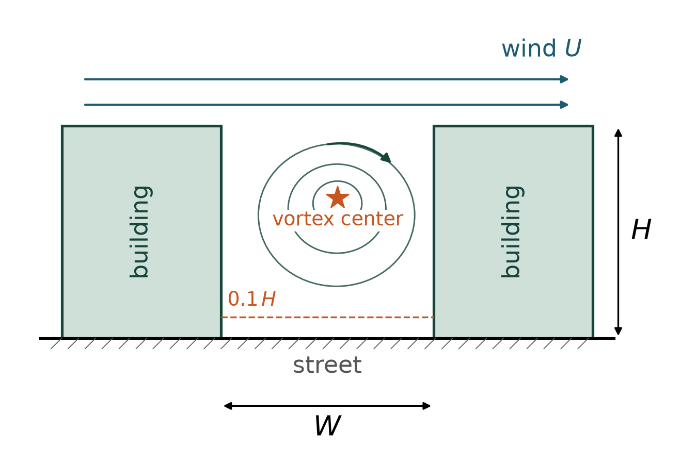
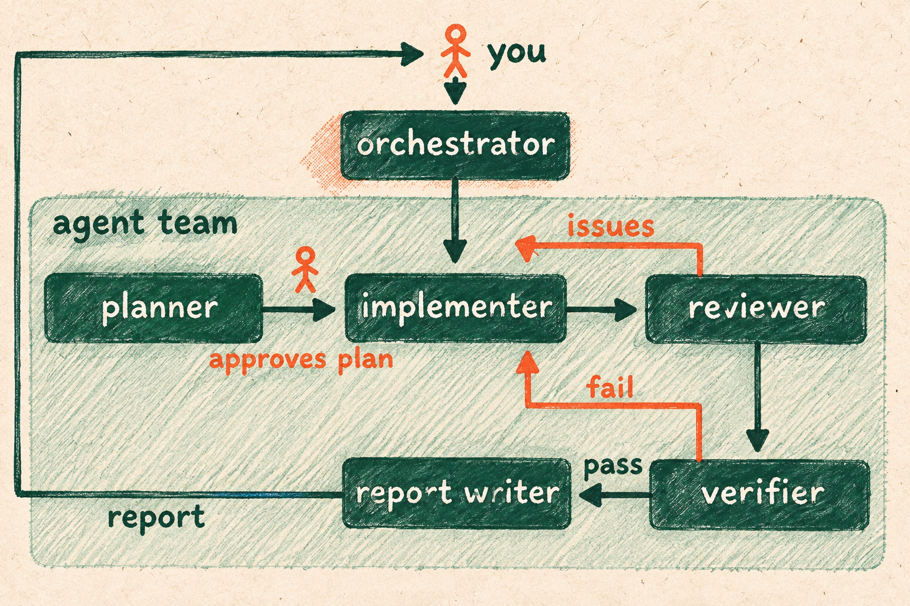
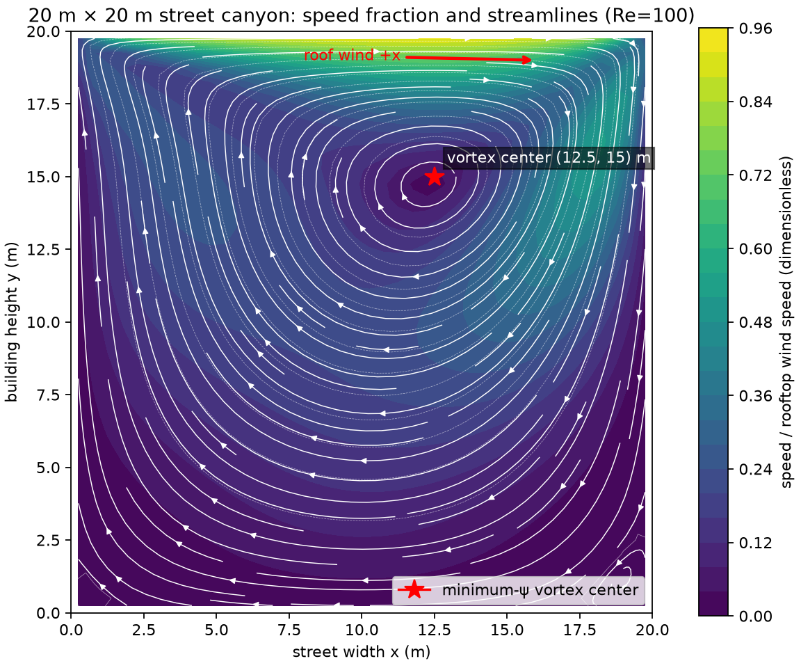
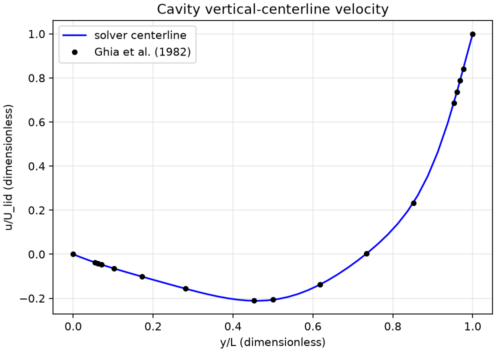

# Wind in a city street

Contributor: Spartan Agentic AI Studio, Michigan State University
Cartoon: Two city buildings seen from the side, with wind blowing over their roofs and a large swirl of air turning between them in the street below.
Run time: about 40 minutes per run
Run cost: about $0.31 per run
Model: GPT-6 Luna, high reasoning effort

## The problem

City planners want to know how air moves in a street between two tall buildings, because the air carries fumes and heat. We picture the street as a square of air, 20 meters on each side, with the wind sliding over its top. The {{agent team}} writes a program that computes how fast the air moves everywhere in that square.

## What we want to find out

- Where is the center of the swirl, in meters from the left building and above the ground?
- How fast does the air move sideways 2 meters above the street, as a share of the roof wind speed?
- Does the program reproduce two known answers, for air between two flat plates and for a box with a moving lid?

## What the agent team does

The {{implementer}}, the {{agent}} that writes code, writes the program and runs it on the street and both known cases. The {{reviewer}} reads the code, and the {{verifier}} runs it again to test the answers. The {{report writer}} turns the tables and pictures into the report you get.

## What the calculation leaves out

- The program treats the air as calm and slow, so the swirl settles into one steady pattern.
- Real city wind is much faster and gusty, which engineers call turbulent.
- So our results show the shape of the swirl, not the real speeds in a street.

## What you need to run it

To run this team, Python 3 and pandoc (a free program that makes the Word report) must be installed on your computer first.

## What a good answer looks like

- When the {{verifier}} runs the program again, it matches both known cases. Between the plates it matches the exact answer to twelve decimal places. In the lid box, its speeds stay within 5 percent of the lid speed from the values published in 1982.
- The program follows the method we set and solves new boxes without changes to its code. It cuts the box into small squares, moves the air forward in time steps, and corrects the pressure each step.
- Every question is answered by a picture or table that the program made, with labeled axes. The {{verifier}} computes the swirl center and the speed at 2 meters on its own and gets the same values.
- The report tells you what to type to rebuild every result, and it names where the 1982 values come from. It says that real streets are turbulent and that AI did the work.

## What the team found

The pictures and numbers come from our first sample run, and the run time and cost come from a second run. Our own calculations agreed with every answer in both runs, and the {{verifier}} passed both with small flaws. In the first run, the program slightly changes the speed you set where air enters some other boxes. In the second, it slightly mismeasures how much the air changes from one time step to the next, but our corrected test still passes. Both runs lose a few numbers from rows of the summary table.

- The swirl center sits 12.5 meters from the left building and 15 meters above the ground. That is high in the street and a little toward the right building, where the wind blows.
- At 2 meters up, the fastest sideways air moves at 6.35 percent of the roof wind speed. It flows against the roof wind, from right to left, because the bottom of the swirl turns the other way.
- Both known cases passed. Between the plates, the program matched the exact answer to thirteen decimal places. In the lid box, its largest gap from the 1982 values was 0.87 percent of the lid speed, well inside the 5 percent limit.

