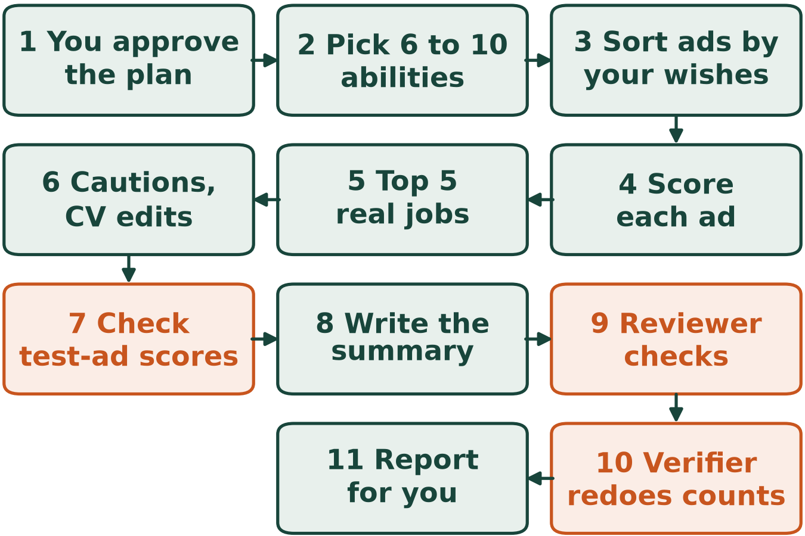
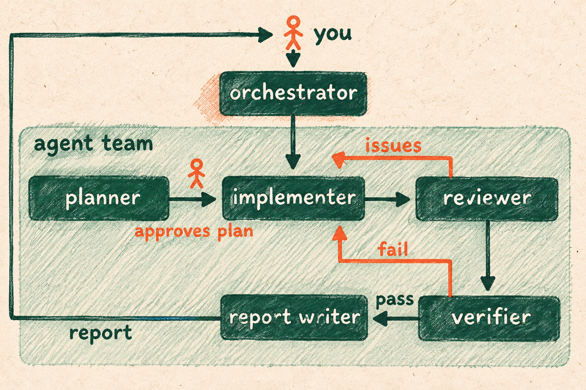

# Match a CV to job ads

Contributor: Spartan Agentic AI Studio, Michigan State University
Cartoon: A desk seen from above with a CV on the left, a fan of printed job ads on the right and a pencil between them.
Run time: about 45 minutes per run
Run cost: about $0.28 per run
Model: GPT-6 Luna, high reasoning effort

## The problem

Finding a job or internship means reading hundreds of ads, so this {{agent team}} compares a CV with 1,362 saved US government job ads. A CV, or résumé, is a summary of your work, schooling and abilities, and the download includes a made-up one. Your own CV would go to the company that runs the AI model, so delete your phone number, address and other private details first.

## What we want to find out

- Of the 1,362 real ads, how many fit everything you want, how many need a closer look, and how many are ruled out?
- Which five real jobs mention the most abilities from the CV, and what does each ask for that the CV does not show?
- Is there an honest CV change that would help for the job with the highest score?
- Do the made-up test ads give the answers we worked out ourselves, what do the practice ads show, and where can this matching go wrong?

## What the agent team does

The {{orchestrator}} is the {{agent}} you talk to, and it runs the others in turn. The {{implementer}} writes a small computer program that does the sorting and counting. Besides the real ads, we made up eight practice ads and three test ads whose right answers we know.

- Step 1: The {{planner}} writes the {{plan}}, and nothing runs until you approve it.
- Step 2: The {{implementer}} picks six to ten abilities that the CV names outright, each backed by a CV line. In our test, Adobe InDesign came from "Laid out 24-page print issues in Adobe InDesign each semester."
- Step 3: It sorts each ad by what you want, such as the job type, place and pay. An ad that breaks one of these is ruled out, and an ad that leaves one unanswered needs a closer look.
- Step 4: The program gives each ad that is not ruled out a score: the percentage of the chosen abilities its text names. An ad that names two of eight abilities scores 25 percent.
- Step 5: Ads with the same title and employer count as one job, and the five real jobs with the highest scores are listed. Among jobs with the same score, those with the lowest ad numbers on the job site come first.
- Step 6: For each of the five, the {{implementer}} quotes what the ad requires and writes a caution, a note on what the CV does not show. For the job with the highest score, it suggests up to three CV edits, or says why none would help.
- Step 7: The program scores the three test ads on two abilities, Adobe InDesign and Figma, and must match our own scores.
- Step 8: The {{implementer}} writes a summary that answers the four questions.
- Step 9: The {{reviewer}} reads the whole result, and the {{implementer}} fixes what it lists.
- Step 10: The {{verifier}} redoes the sorting and counting on its own and sends any difference back.
- Step 11: The {{report writer}} writes the report you read, including whether the {{verifier}} passed the work.

## How the match works and what it leaves out

- The sorting looks at only four things: whether the ad is open, the job type and hours, the place, and the pay.
- It keeps ads from other fields, so the five jobs in our test are far from design.
- Only exact words count, like the keyword filters some employers use to sort applications. A score of 0 does not mean you are unsuited for the job.
- Required degrees or certificates appear only as cautions, and the team never judges whether you may work in a country.

## What you need to run it

A run stops when it has spent $3.

## What a good answer looks like

- The test ads get the scores we worked out, and removing an ability from a test ad lowers its score. A test ad that requires a certificate the CV lacks still gets a caution.
- Only ads that are not ruled out get a score, and every ability comes from an exact CV line. Only real ads make the list of five. If too few real jobs match, the summary says so and adds no made-up ones.
- Every quote is copied word for word, and a job is never called a fit just because its ad uses the CV's words. A CV edit only rewords what the CV already says.
- The summary answers all four questions and keeps real, practice and test ads in separate tables. It names where and when the ads were saved and says that AI did the work.

## What the team found

Our test used a made-up studio art student who wants a summer design or photography internship. It can be full or part time and paid or unpaid, in Michigan, Chicago or London, or remote from the US or UK.

- No real ad fits everything. 70 need a closer look because their ads do not say whether the work is in person, hybrid or remote. 19 of them also do not say whether the job is an internship. The other 1,292 are ruled out, most because they are not internships.
- The team picked eight abilities from the CV: Adobe InDesign, Illustrator, Photoshop, Lightroom, Figma, studio lighting, DSLR camera and hand lettering. None of the 70 ads names any of them, so all score 0. The five listed are the tied jobs with the lowest ad numbers. They are not recommendations, and the CV shows none of what they ask for.
- The prevention specialist ad asks for a behavioral or social science degree. The information technology specialist ad asks for a computer science degree or IT experience. The logistics management specialist ad asks for top grades, graduate study or logistics experience. The social services assistant ad asks for a year of mental health support work. The radiologic technologist ad asks for X-ray training and certification.
- The team found no honest CV change for the prevention specialist job, the first of the five. Its ad asks for a behavioral or social science degree, so the team suggested nothing.
- Two test ads named both abilities and scored 100 percent, as we worked them out. The third was ruled out for its location and got no score. The test ad that requires a first aid certificate kept its caution despite its top score. Removing Adobe InDesign from one test ad left one of two abilities, so its score dropped from 100 to 50 percent.
- The four made-up art and design internships among the practice ads scored 0 to 37.5 percent, and the four healthcare ones were ruled out. The print design internship scored highest, naming three of the eight abilities. The real ads were saved on October 20, 2026, so some may have closed.
