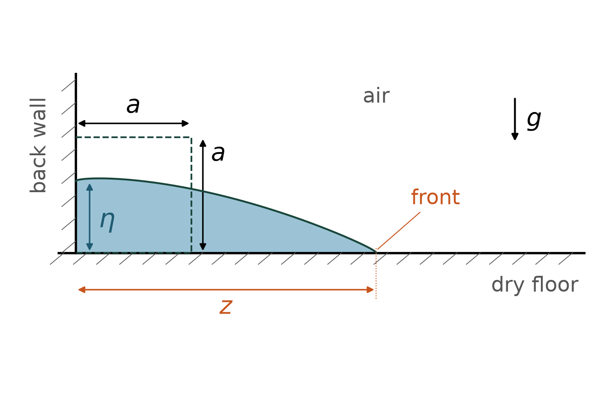
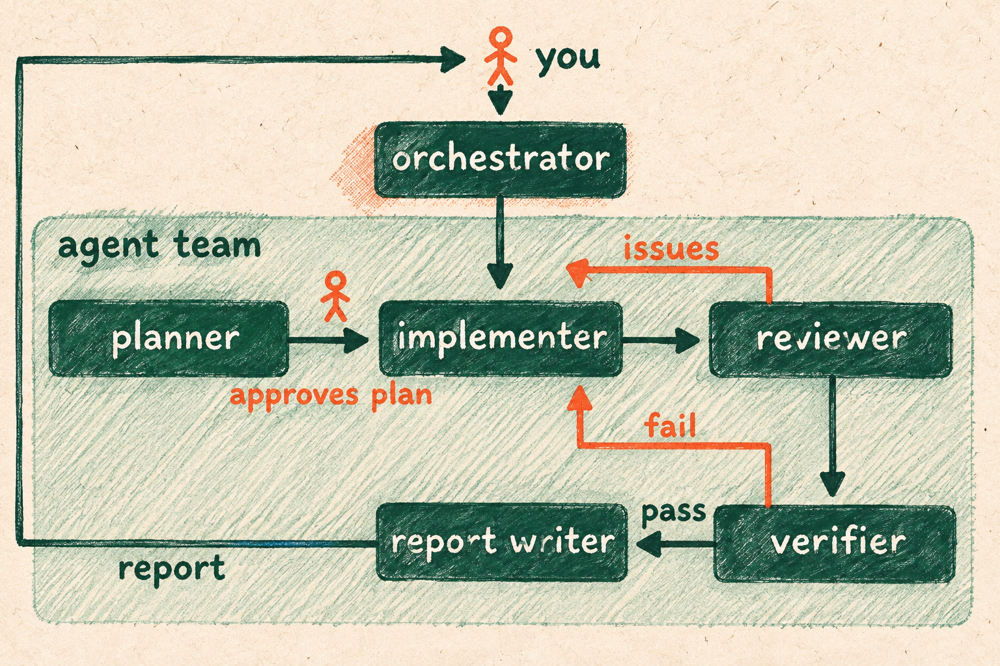
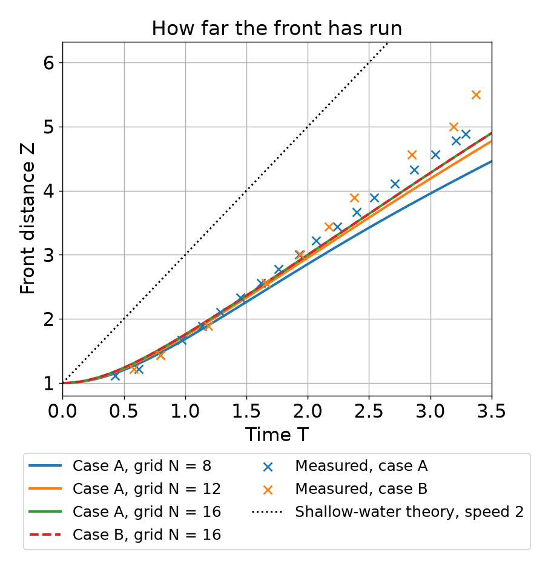
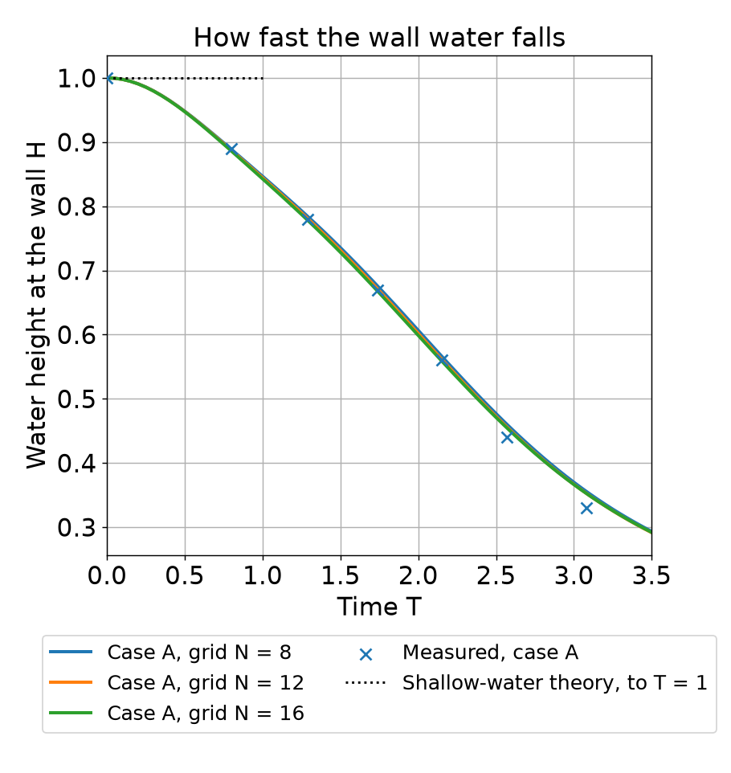

# How fast does water run when a dam breaks?

Contributor: Phanikumar Mantha, Civil and Environmental Engineering, Michigan State University
Cartoon: A dam seen from straight above holds a lake on the left; below it a river runs right through a forested valley to a village and a bridge.
Video: Yellow water falls and spreads right beneath purple air in our side-view calculation. x/a is distance along the floor and y/a is height, both in starting block widths; T is time in units of about 0.076 seconds.
Run time: about 25 minutes per run
Run cost: about $0.20 per run
Model: GPT-6 Luna, high reasoning effort

## The problem

When a dam breaks, towns downstream need to know how fast the flood arrives. Engineers test flood programs on a lab experiment: a square block of water is released onto a dry floor. We compute the experiment that the researchers Martin and Moyce filmed in 1952 and compare with their numbers.

## What we want to find out

- How far does the front, the leading edge of the water, travel over time? Does it match the 1952 measurements for the small 2.25-inch block and the large 4.5-inch block?
- How fast does the water drop at the back wall, behind the block? Does it match the 1952 measurements?
- Does the answer change when the program cuts the water and air into more, smaller squares?
- Why does the shallow-water theory predict a faster front than Martin and Moyce measured? This simple theory treats the flood as a thin layer of water.

## What the agent team does

In the sample {{run}}, we approved the {{plan}} by typing the word Approve. You get the program, result tables, two plots, a video of the collapse and a report on the four questions.

## How we set up the calculation

Our program cuts the side view into small squares, 8, 12 or 16 across the block. Distances are in block widths, and one time unit is about 0.076 seconds for the small block. The program leaves out surface tension, the pull that holds a water surface together, and friction at the walls. It stops at 3.5 time units, so we skip the last two 1952 height measurements.

## What you need to run it

To run this team, Python 3 and pandoc (a free program that makes the Word report) must be installed on your computer first.

## What a good answer looks like

- The calculated front and wall height match the 1952 measurements. The front must stay within half a block width or 20 percent of each measurement, whichever is larger. The wall height must stay within 5 percent of its starting height. A rerun must give the same numbers. The program must also move a strip of water across the squares without loss, much smearing or false ripples.
- Smaller squares and the larger block barely change the answer. Each step to smaller squares may shift the front by at most 0.3 block widths. It may shift the wall height by at most 0.02 of its starting height. The large block must match the small block even more closely.
- Still water half a block deep must stay still and keep all its water. Pressure is the water's push on each bit of area. The pressure difference between the bottom and top must match a hand calculation within 0.01 percent.
- The report answers every question with numbers from the result tables. It says where our front is ahead of the measured front and where it is behind. It names every simplification as a limit. It ends by naming the AI model that wrote it and saying the two 1952 tables were the only data.

## What the team found

Our plots and video come from an earlier version of the team. The time and cost come from a later version. That version passed with one small flaw, which moves the front by at most 0.004 block widths. Its report also missed some sections. We have not fully tested the latest changes to the team's instructions.

- Our front stays within the allowed gap at all 29 measurements, 19 for the small block and 10 for the large. Our front is ahead of the measured front early on and behind it later. The worst gap is about 0.25 block widths for the small block and 0.76 for the large one. The allowed gaps are wide, so passing them does not prove the calculation is that accurate.
- Our wall height stays within 2.3 percent of the starting height at every measurement. The worst gap is at 3.08 time units. There the experiment measured 0.33 of the starting height, and we got about 0.35. The 1952 release time is not known exactly, so the measured points could shift a little in time.
- From 8 to 12 squares across, the front changed by up to about 0.23 block widths. From 12 to 16, it changed by up to about 0.09. Both are within the allowed 0.3, but the front has not fully stopped changing. The wall height changed by less than 0.5 percent of its starting height, so it has stopped changing. The large block matches the small one within about 0.0004 block widths in front and 0.0001 in wall height. In the still-water test, the pressure difference matched the hand value exactly.
- The shallow-water theory assumes the pressure depends only on the water's depth. That holds only when the water is not speeding up or slowing down. Under this theory, the front moves at 2 block widths per time unit. At the start, the top of the block falls faster and faster. The pressure there drops, so the push toward the front weakens. Our calculation shows this early fall. By 1 time unit, the wall height is down to about 0.84, while the theory still gives 1. Our front speed from 2 to 3 time units is about 1.28 block widths per time unit. That is below the theory's 2 and below the fastest measured speeds of 1.62 and 1.66. Our speed rises from about 1.10 to 1.24 to 1.28 as the squares get smaller. So coarse squares also slow the front, and we cannot say how much of the gap comes from the physics.

