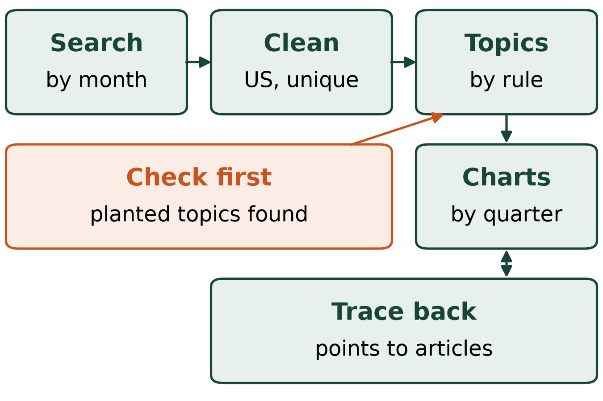
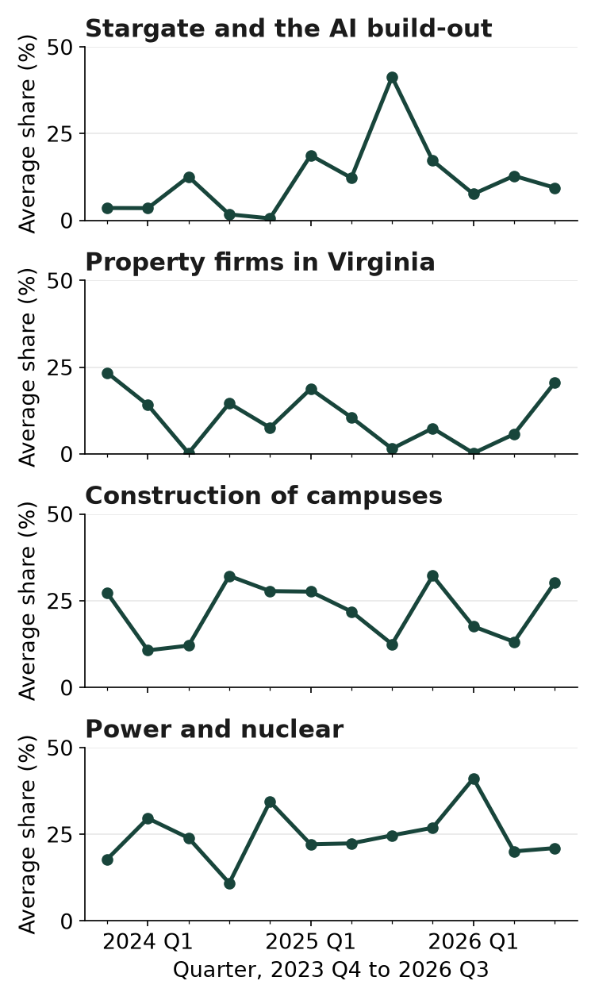
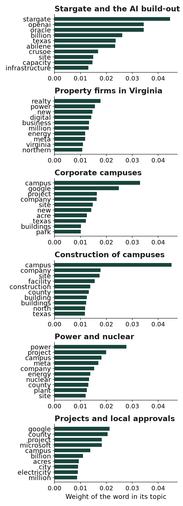

# Data centers in the news

Contributor: Titi Kou-Herrema, Digital Humanities, Michigan State University
Cartoon: A data-center campus being built on farmland, seen from above: one finished hall with cooling fans on its roof beside the steel frame of a second hall, with cranes, trucks and workers.
Run time: about 110 minutes per run
Run cost: about $1.51 per run
Model: GPT-6 Luna, high reasoning effort

## The problem

A data center is a large building full of computers that run websites and AI services. From October 2023 to September 2026, US news ran more articles about new ones than one person can read. We look for the subjects this news kept returning to, which a program finds as topics, or groups of words that often appear together.

## What we want to find out

- Where did the articles come from, how were they searched, and how many outlets, such as newspapers and trade magazines, published them?
- How many topics does a rule set before the run choose, and how close were the other numbers it tried?
- What are the topics, and how do the four that changed most rise and fall over 12 quarters of three months?
- Which topics rise and fall together, or in opposite directions, and which articles does that point to for close reading?
- How can you follow a topic, a point on a chart or two linked topics back to their articles?
- How do we respect copyright, since every article still belongs to the outlet that published it?

## What the agent team does

In this {{agent team}}, the four {{searchers}} each run nine of the 36 monthly web searches, one search per month. The {{implementer}} writes the programs that keep the US articles, find the topics and draw the charts. The {{reviewer}} reads the work for problems, and the {{verifier}} repeats it on its own before the {{report writer}} writes your report.

## What the topics can and cannot show

- The search favors well-known outlets and recent articles, so our articles do not stand for all US news on data centers.
- The program reads only the short excerpt the search shows for each article, never the full article.
- A topic name, such as power and nuclear, is our own reading of its top words and articles.
- Twelve quarters are too few to prove that one topic causes another, so topics that move together are only clues.

## What you need to run it

A run stops when it has spent $3.

## What a good answer looks like

- The {{verifier}} hides known topics in made-up news, and the programs must find them and how they rise and fall. Finding a known answer is why we trust the programs on real news.
- Running the programs again on the saved search results gives the same numbers, and the charts agree with them.
- There are at least 130 real articles from at least 40 outlets, and at most one link in twenty no longer opens. No article text is shared, because the articles belong to their publishers.
- Every file the team promised is there, and the report answers each question from the results. The report also says that the search favors well-known outlets and that AI produced it.

## What the team found

Our sample run met all four points above, and a second, independent test at the Studio agreed.

- Each monthly search used only the words data centers, the month and year, and United States. The 36 searches returned 288 results. The team kept each US news or trade article once, which left 155 articles from 58 outlets.
- The rule tried every number of topics from three to twelve. It gave each number a score that is higher when each topic's top words share more articles. Six topics scored highest, at 0.0750, just ahead of ten topics at 0.0746, so the choice was close.
- We named the six topics from their top words and articles. They are Stargate and the AI build-out, property firms in Virginia, corporate campuses, construction of campuses, power and nuclear, and projects and local approvals. Stargate is a large AI data center project of the companies OpenAI and Oracle.
- Each article mixes several topics, and a topic's share is the part of an article it fills, averaged over a quarter. We chart the four topics whose share changed most from the first two quarters to the last two. Stargate rose from about 4 to 11 percent and peaked at 41 percent in July to September 2025. Over the same span, property firms fell from 19 to 13 percent.
- A correlation runs from minus 1 to 1 and says how closely two topics rise and fall together across quarters. Property firms and construction moved together, at 0.57, and construction and local approvals moved oppositely, at minus 0.61. Within single articles, all fifteen pairs of topics had slightly negative correlations. Shares that add up to 100 percent can cause this, so it does not show that the subjects avoid each other. The quarters where property firms and construction were both high or both low are worth reading closely.
- The tables list the articles behind each topic and each quarter, with their titles, outlets, dates and links. For example, the Stargate peak leads to seven articles, the first a CNBC news article of July 22, 2025. One of the 155 links now opens a page that was taken down.
- The excerpts the program read stayed in the run's private working folder. We share only tables, charts, titles and links, never article text.

