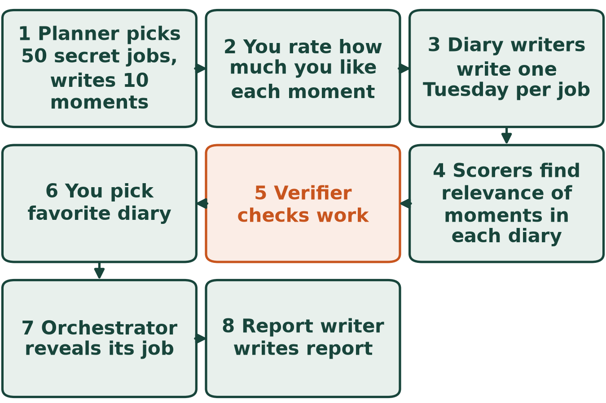
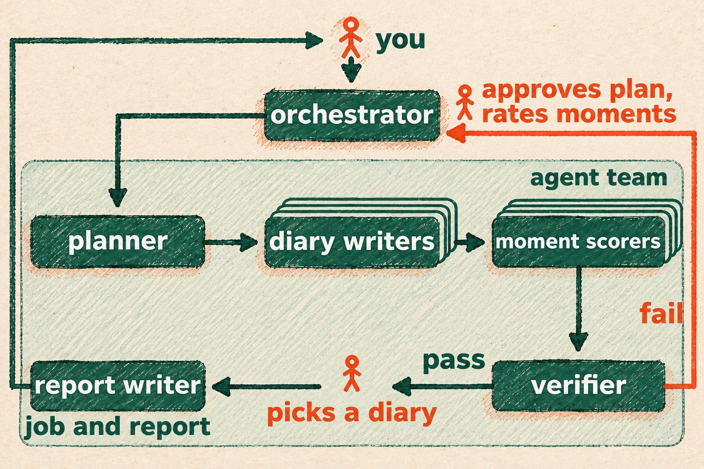

# Pick a future by its Tuesday

Contributor: Spartan Agentic AI Studio, Michigan State University
Cartoon: An open diary on a desk seen from above, with a garden trowel, a wrench, a stick of chalk and a cup of coffee around it.
Run time: about 50 minutes per run
Run cost: about $0.71 per run
Model: GPT-6 Luna, high reasoning effort

## The problem

A job title makes you think about how respected the job is and who does it. What you actually live with is an ordinary working day, such as a Tuesday. This {{agent team}} lets you pick a job by diaries of its Tuesdays, built from moments such as dealing with something unexpected, before you see any job title.

- Step 1: The {{planner}}, an AI helper, writes the {{plan}}: the steps for this run and the checks its result must pass. It lists 10 moments: small parts of a workday, such as handling something unexpected. It also picks 50 different jobs so that each moment fits some of them. Each job gets a secret label, such as J13, so its name stays hidden from you.
- Step 2: You read the {{plan}} and approve it, or ask for changes. Then you look at the moments, not the jobs, and rate how much you like each one from 1 to 5. A 1 means you would rather not have it, and a 5 means you like it a lot.
- Step 3: Several diary writers, also AI helpers, work at once, each on a share of the jobs. Each invents a diary of an ordinary Tuesday in that job, about 150 words, never using a word of the job's name.
- Step 4: Several moment scorers work at once, each on a share of the diaries, and never see the job names. They find how relevant each of your 10 moments is in the diary, from 0 if it never happens to 5 if it clearly happens. This mark is about the diary, not about how much you like the moment. For each mark they copy the line from the diary that shows it.
- Step 5: The {{verifier}} checks the work of the diary writers and moment scorers against the three points under "What a good answer looks like". Work that fails goes back to be redone before you see any diary.
- Step 6: The team ranks the diaries by how well their moments match your ratings, as "How the diaries are ranked" explains. You read the best ones, shown only by their labels, and pick the Tuesday you like best.
- Step 7: Only now does the {{orchestrator}}, the AI helper you talk to, tell you the job behind your diary. That is the job whose Tuesday you liked best, chosen before you knew what it was.
- Step 8: The {{report writer}} writes your report as a Word file: the task, the checks, the results and how the team worked. You add your own judgment before you hand it in.

## What we want to find out

- What matters most to you in an ordinary workday?
- Which diary would you pick if you could not see the job title?
- What job is behind the diary you picked?

## What the agent team does

The {{orchestrator}} is the {{agent}} you talk to, and it gives every other {{agent}} one task. To start, open the downloaded folder in OpenCode and type /do followed by "Read the task file."

## How the diaries are ranked

- The team picks the rule and shows it with the best diaries.
- In our run, a diary's score was the average of its marks, where each moment counts as many times as your rating.
- A moment you rated 5 counts five times, and one you rated 2 counts twice.
- Only your ratings and the marks count. Pay, schooling and the place of the job do not.

## What a good answer looks like

- No job name reaches you or the moment scorers before you pick.
- Every scored moment comes with a line copied word for word from its diary.
- Most moments show up in the diaries.

## What the team found

In our test, our tester asked for a smaller run first: 5 moments and 25 jobs instead of 10 and 50. The run took about 50 minutes and cost about $0.71.

- Our tester rated the moments 3, 2, 5, 4 and 4. The one liked most, with a 5, was a stretch of focused work: "I spend a stretch of focused time reviewing information and completing or updating the work in front of me."
- Our tester picked diary J13 without seeing any job name. It ranked fourth of 25, with 4.89 out of 5. Three diaries tied for first at 5.0, because these five moments fit most jobs.
- J13 was a journalist. The scorers gave its first moment a 5 and quoted "Tuesday morning began with the newsroom calendar, overnight messages, and a call to my editor about the neighborhood meeting."
- Every moment showed up in the diaries, so the third point was met.
- The first point was not met. An early scoring round saw a diary that held the job title. We threw that round away and five new scorers redid it.
- The second point was not met either. One copied line did not match its diary word for word. We fixed it, and our tester chose not to check it again, so the team's own verdict was FAIL.
