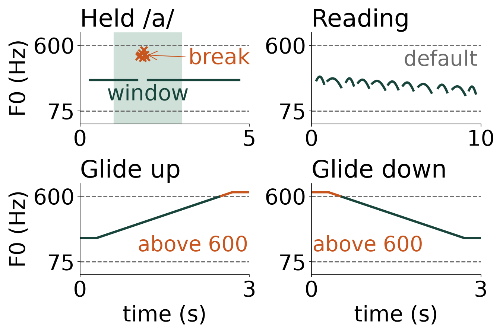
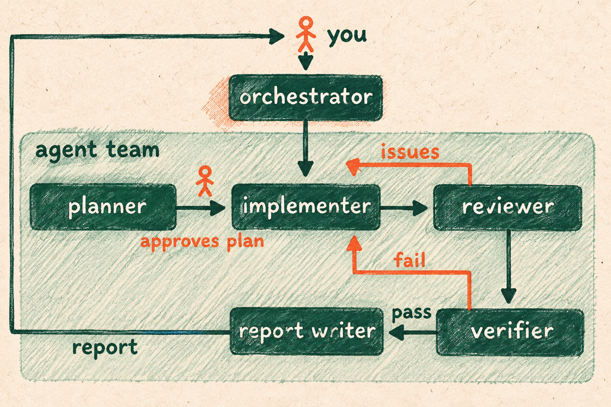
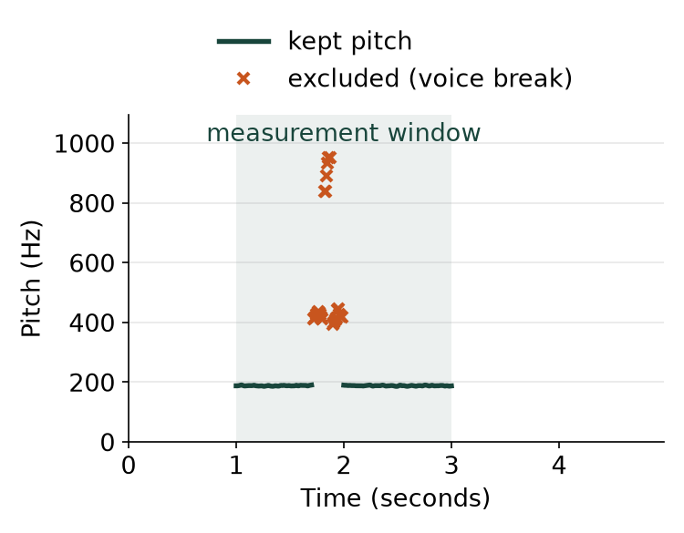
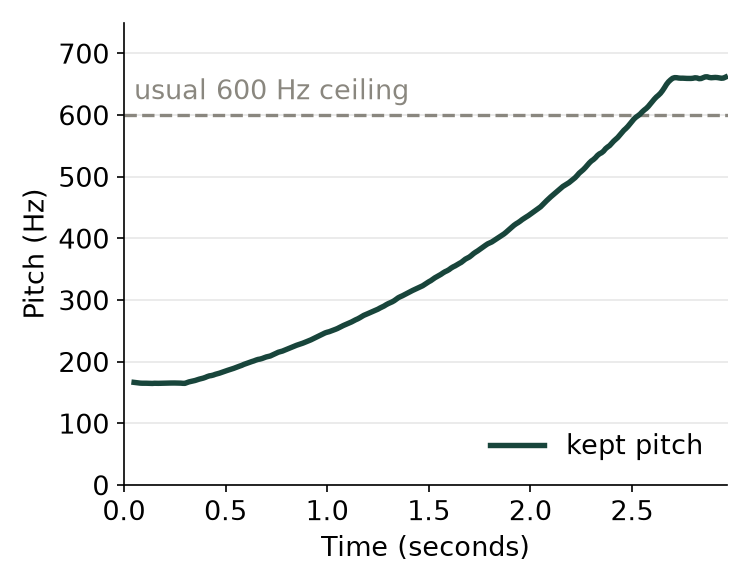

# Measuring a voice from its recordings

Contributor: Maryam Naghibolhosseini, Communicative Sciences and Disorders, Michigan State University
Cartoon: A table seen from above, with a microphone headset wired to an open laptop whose screen shows a wavy pitch line.
Run time: about 45 minutes per run
Run cost: about $0.22 per run
Model: GPT-6 Luna, high reasoning effort

## The problem

Speech-language pathologists treat voice problems, and they measure a voice from its recordings. A computer made four recordings for a made-up student: a held "ah", written /a/, a passage read aloud, and two "ah" glides, one up and one down. We want each recording's pitch in hertz (Hz), or vibrations per second; the free program Praat measures it, searching only a set range, usually 75 to 600 Hz.

## What we want to find out

- How does the average pitch of the held "ah" compare with that of the reading?
- Which of these two recordings varies more in pitch, and what might explain the difference?
- What are the lowest and highest pitches in the reading, in each glide and in both glides, leaving out places Praat got wrong?
- Which published study, if any, measured a group of people with the student's age, sex, language and recording task?
- How do the student's measurements compare with that study's values, and what might explain any difference?

## What the agent team does

An {{agent team}} is a set of {{agents}}, AI models that each do one job. The {{implementer}} runs Praat on each recording, leaves out wrong values, works out the pitch numbers and finds published values to compare. The {{verifier}} measures the recordings again on its own and judges the work on the three points below, and the {{report writer}} then writes your Word report.

## What the recordings are and what a comparison can say

- The made-up student is a 22-year-old woman who grew up speaking American English.
- The held "ah" was made at a steady 188.0 Hz, with one voice break, where the voice stops vibrating evenly.
- The reading rises and falls like speech but has no words.
- A comparison with one group is not a diagnosis, and a close value does not prove a healthy voice.

## What a good answer looks like

- The measurements are right. The held "ah" comes within 1.0 Hz of the 188.0 Hz it was made at. Every number matches the {{verifier}}'s own measurement within a small allowance. Each recording's picture shows any wrong values left out.
- Every comparison uses a real published group with the student's age, sex, language and kind of task. Its numbers are copied exactly, and the distance from its average is worked out correctly. When no group matches, the answer says so.
- The team delivers its code, tables, a picture of each recording and a summary. The summary answers the five questions from the tables and marks its assumptions. It makes no diagnosis and says AI did the work on made-up recordings.

## What the team found

The {{verifier}} passed the answer on all three points. Two small slips in the notes change no measurement or comparison: some combined table rows leave out some settings, and the {{verifier}}'s notes count six unmatched measurements instead of four.

- The held "ah" averages 188.2 Hz over seconds 1 to 3, the stretch used for measuring. During its voice break, Praat reported 24 wrong values far above the voice, which the team left out. The reading averages 195.7 Hz, 7.6 Hz higher (worked out before rounding).
- The reading varies far more. The spread within a recording is how far its values typically sit from their average. It is 35.1 Hz for the reading and 1.0 Hz for the held "ah". The team suggests, without testing it, that speech rising and falling causes this.
- The reading runs from 125.4 to 256.6 Hz. The glide up runs from 164.6 to 661.9 Hz, and the glide down from 149.3 to 641.3 Hz. So both glides together span 149.3 to 661.9 Hz. Above the top of its range, Praat counted only every second vibration and reported about half the true pitch. So the team widened the range to 50 to 1200 Hz.
- One group matched, 104 women aged 18 to 27 who learned English as young children, from a 2016 thesis by Goy. Their held "ah" averages 251 Hz, and their reading 208 Hz. Within one reading, their pitch has an average spread of 45 Hz. The thesis has no glides, but the task rules count a highest held note as the same kind of task as a glide's top. So the team compared both glide tops with the group's highest held note, 517 Hz. No group matched the reading's lowest and highest pitches or the glide bottoms.
- For the held "ah", the spread between people in the group is 28 Hz. Our 188.2 Hz sits 2.24 of these spreads below their average. 251 minus 188.2 is 62.8, and 62.8 divided by 28 is 2.24. Beyond 2 spreads counts as outside the group's usual range, and the other compared measurements fall within it. The held "ah" was made at 188 Hz on purpose, so outside here means lower than this group, not a diagnosis. Differences may come from our short computer-made recording and from comparing glides with held notes.

