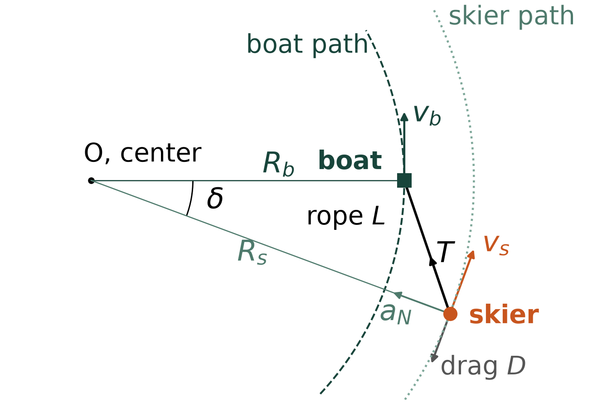
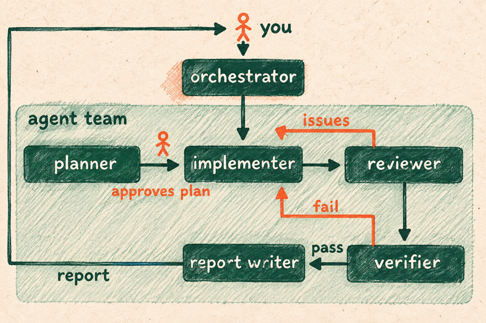
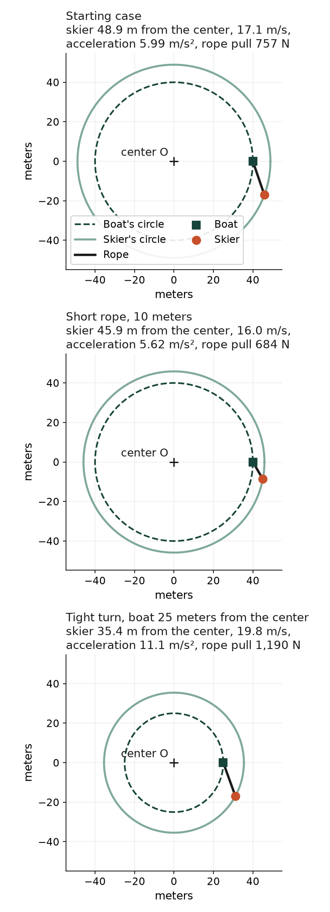
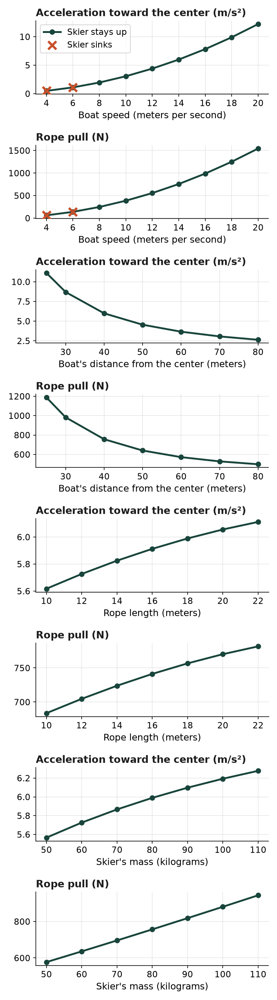

# A water skier on a turn

Contributor: Tamara Reid Bush, Mechanical Engineering, Michigan State University
Cartoon: A motorboat seen from above turns left on a lake and pulls a water skier on one ski by a long rope; the skier swings out wide behind the boat.
Run time: about 30 minutes per run
Run cost: about $0.21 per run
Model: GPT-6 Luna, high reasoning effort

## The problem

In a slalom water skiing contest, a skier on one ski swings far out behind a motorboat to pass floating markers. In our simpler case, the boat circles at a steady speed and the skier follows on a bigger circle. Going around a circle, the skier keeps changing direction, and physics calls this an acceleration toward the center (normal acceleration).

## What we want to find out

- When the boat goes faster, how do the skier's speed, acceleration toward the center and rope pull (rope tension) change, and can the skier stay up (planing)?
- What does a smaller or larger boat circle do to the skier's speed and the rope's pull?
- What does a longer or a shorter rope do to the skier's speed and the rope's pull?
- What does a heavier or a lighter skier do to the skier's speed, the rope's pull and the speed needed to stay up?
- When is the skier too slow for the ski to hold them up, so that the skier sinks?

## What the agent team does

You chat with the {{orchestrator}}, which starts the {{planner}}, and the work goes on once you approve the {{plan}}. The {{implementer}} writes a small program that computes the skier's motion, a table of results, two figures, a slider page and a short written summary. The {{report writer}} then writes a Word report that answers the questions.

## What the formulas assume

- The boat and the skier take the same time to go around, and the rope is straight, tight and weightless.
- Along the water, only the rope's pull and the water's drag push on the skier, and the ski gives no sideways push.
- The most the ski can push the skier up (lift capacity) grows with the square of the skier's speed.
- These are simplifications, so the numbers do not predict real skiing.

## What you need to run it

A run stops when it has spent $3.

## What a good answer looks like

- The numbers must be right. The {{verifier}} recomputes every number in the results table and on the slider page. Each must agree within half a percent. It also compares a case without water drag with a hand calculation.
- The figures and the slider page must show those numbers and answer each question. The page must work without internet, fit a phone screen and use plain words with units written out.
- The written summary must answer each question with numbers from the table. It must present the assumptions as simplifications, not as facts about real skiing. It ends by naming the AI model and saying that no outside or private data was used.

## What the team found

Our sample run met all three points above, and a second, independent test at the Studio agreed.

In our starting case (the check case), the boat goes 14 meters per second (about 31 miles per hour), 40 meters from the center. It pulls an 80-kilogram skier on an 18-meter rope. Both take the same time to go around, and the skier's circle is bigger, 48.9 meters from the center. So the skier moves faster, at 17.1 meters per second. The rope pulls with a force of 757 newtons, about the weight of a 77-kilogram person. The skier's acceleration toward the center is 5.99 meters per second squared, about six tenths of a falling object's acceleration.

- When the boat speeds up from 4 to 20 meters per second, the skier's speed, acceleration toward the center and rope pull all rise. The skier's speed goes from 4.9 to 24.4 meters per second, and the pull from 62 to 1,540 newtons. At boat speeds of 4 and 6 meters per second, the skier moves slower than 8.9 meters per second and sinks. From a boat speed of 8 meters per second up, the skier stays up.
- A larger boat circle slows the skier and eases the rope's pull. When the boat's distance from the center (boat path radius) grows from 25 to 80 meters, the skier's speed falls from 19.8 to 15.0 meters per second. The rope's pull falls from 1,190 to 499 newtons. On a wider boat circle, the 18-meter rope adds a smaller share to the skier's circle. So the skier's speed comes closer to the boat's 14 meters per second.
- A longer rope makes the skier a little faster and the pull a little stronger. From 10 to 22 meters of rope, the skier's speed rises from 16.0 to 17.5 meters per second. The pull rises from 684 to 782 newtons. In a real contest a shorter rope makes skiing harder, for reasons these simple formulas leave out.
- A heavier skier goes faster and pulls harder on the rope. From 50 to 110 kilograms, the speed rises from 15.9 to 17.9 meters per second and the pull from 577 to 944 newtons. At a fixed speed, the water's drag does not depend on mass. A heavier skier needs a stronger pull toward the center. So the skier trails less far behind the boat and swings onto a wider circle. The speed needed to stay up rises from 7.0 to 10.4 meters per second.
- The skier sinks when the lift capacity is less than the skier's weight. In the starting case, the ski can push up almost four times the skier's weight. The skier would sink only below a speed of 8.9 meters per second.

The {{verifier}} recomputed every number in the table and on the slider page and found no mismatch. It also checked a case a hand calculation can solve. With the water's drag set to zero, the skier sits straight out from the boat, 40 + 18 = 58 meters from the center. The speed grows with the circle's size: 14 × 58 / 40 = 20.3 meters per second. The team's program agreed.

Below is the slider page from our test {{run}}. Its four sliders set the boat's speed, the boat's distance from the center, the rope length and the skier's mass. Each slider moves a dot on two plots. A list shows the numbers for your settings and says whether the skier stays up.
